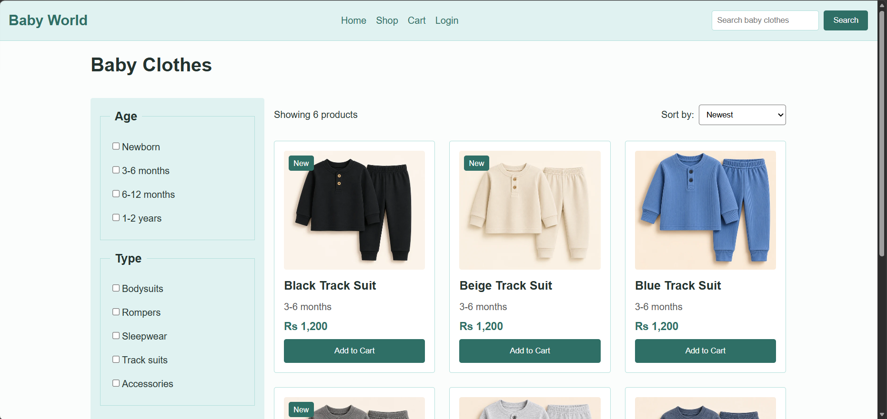
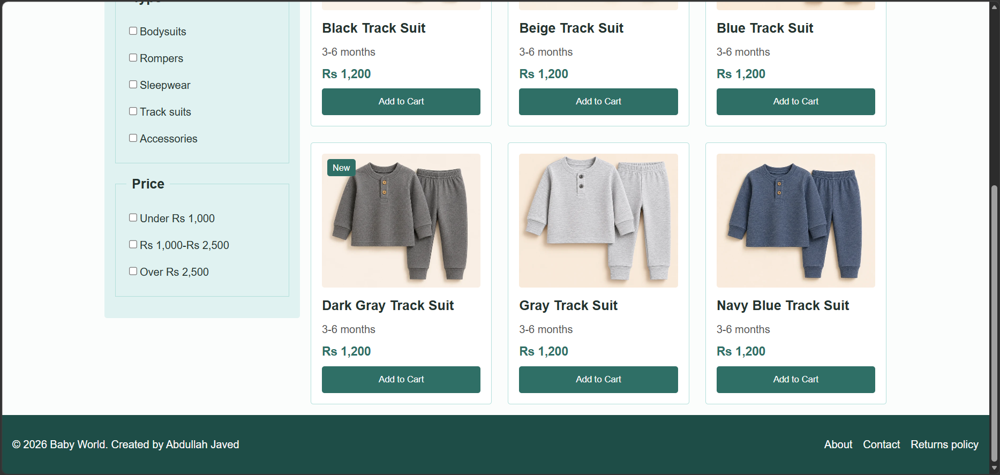

# Baby World - Online Baby Clothes Store (Front Page)

I design this page just for my assignemnt.The goal is to understand what HTML tags are and how to use them.

## Preview




## Goal

Create a front page for an online store using only HTML tags and basic CSS declarations, with a two-column layout. No Bootstrap and no JavaScript.

## Page Sections

- **Header:** store logo, main menu, and search box
- **Left column:** filters for age, type, and price
- **Right column:** sort dropdown and a grid of product cards (image, name, age range, price, "Add to Cart" button)
- **Footer:** copyright line and links

## Built With

- **HTML5:** semantic tags (`header`, `nav`, `aside`, `main`, `section`, `article`, `footer`) and form elements (`fieldset`, `legend`, `label`, checkbox, `select`)
- **CSS:** [list what you used, for example Flexbox, box model (margin, padding, border), colours, hover effects]

## Project Structure

```
assignment-01-baby-world/
├── index.html
├── style.css
├── screenshot-01.png
├── screenshot-02.png
└── images/
```

## How to Run

Download or clone this repository and open `index.html` in any web browser. No installation is needed.

## What I Learned

- Semantic tags like `header`, `nav`, `aside`, `main`, `section`, `article` and `footer` give a page a clear structure, which is more meaningful than stacking plain `div`s. I also learned how form elements fit together: a `fieldset` takes one `legend`, and a `label` wrapped around a checkbox makes the text clickable.
- Flexbox is what makes the two-column layout work. Setting `display: flex` on the parent puts the sidebar and the product area side by side, and `flex: 1` on the main area makes it take the remaining space. The box model (padding, margin, border) and `box-sizing: border-box` then control the spacing and sizing.
- The "New" badge pushed the text down on cards that had it, so the cards didn't line up. I fixed it by setting `position: relative` on the card and `position: absolute` on the badge, so it sits over the corner of the photo instead of taking up its own line.

## Credits

- Instructor: Mr. Rao Nasir, for guidance
- Resources: W3Schools HTML and CSS tutorials [add anything else you used]

## Author

[ABDULLAH JAVED]
[[LinkedIn](https://www.linkedin.com/in/abdullah-javed-id01/)]
[[GitHub](https://github.com/Abdullah-Javed-01)]
